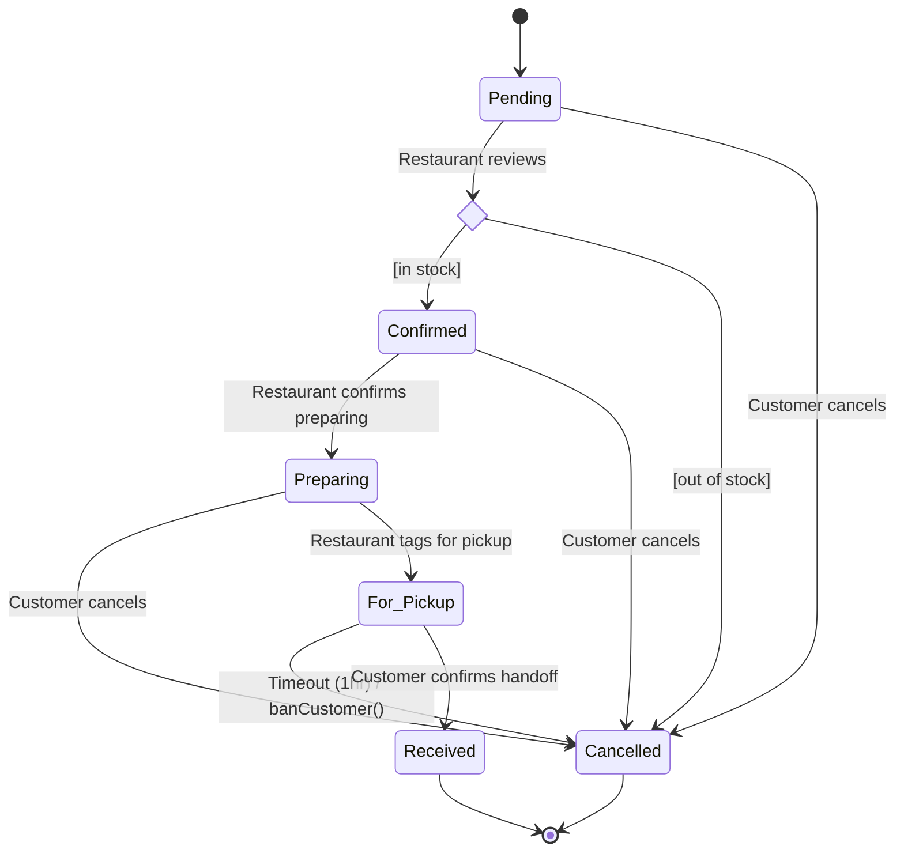

# OrderTaker — Food Ordering REST API

A Spring Boot backend for a food ordering platform connecting customers and restaurants, built as a portfolio project to demonstrate backend API design, relational data modeling, and secure REST API development.

## Table of Contents
- [Overview](#overview)
- [What’s Implemented](#whats-implemented)
- [Tech Stack](#tech-stack)
- [Data Model](#data-model)
- [Planned Order Status Lifecycle](#planned-order-status-lifecycle)
- [API Design and Current Implementation](#api-design-and-current-implementation)
- [Next Steps](#next-steps)
- [Getting Started](#getting-started)
- [Future Enhancements](#future-enhancements)
- [Author](#author)

## Overview

OrderTaker models the core flow of a food ordering platform: customers browse restaurants and menus, build a cart, place an order, and track it through to pickup, while restaurant owners manage their menu and fulfill incoming orders. Particular attention went into data integrity — soft-deletes that preserve order history, price snapshotting at checkout — and into modeling the order lifecycle as an explicit state machine rather than an open-ended status field.

## What’s Implemented

- Project scaffolded as a Java 21 / Spring Boot application using Maven.
- Initial JPA entities and repositories for users, customers, restaurants, menu items, carts, and orders.
- Request/response DTOs and MapStruct mappers for customer profiles, menu items, and orders.
- Basic menu-item operations, including restaurant menu lookup and soft deletion.
- Initial customer lookup and order endpoints, plus profile endpoint scaffolding.
- Initial order creation with server-calculated totals, menu-item price snapshots, and checks for missing items and restaurant ownership.
- An order status enum with sequential transitions and terminal `RECEIVED` and `CANCELLED` states.
- A global exception handler with not-found, validation, and optimistic-locking responses.
- Initial product scope, ERD, order lifecycle diagram, and endpoint contract in [`docs/`](./docs/).

This is an in-progress backend, not yet a complete or secured ordering service. Cart workflows, authentication/authorization, full CRUD, and automated coverage of business rules remain to be implemented. See [Next Steps](#next-steps) for the current work list.

## Tech Stack

- **Language:** Java
- **Framework:** Spring Boot (Spring MVC and Spring Data JPA)
- **API documentation:** Springdoc OpenAPI dependency is included; endpoint generation and UI still need to be verified.
- **Auth:** JWT-based authentication is planned; authentication and authorization are not implemented yet.
- **Database:** PostgreSQL connection settings are read from environment variables; Flyway applies the initial schema migration on startup.
- **Build tool:** Maven

## Data Model

The model has a shared `User` identity with customer and restaurant profiles; a restaurant owns its menu items; a customer can have a cart made up of cart items; and an order contains order items with a price snapshot.

| Entity | Role |
|---|---|
| `Users` | Shared identity table for both account types (email, password, role) |
| `Customers` | Customer-specific profile data, linked to a `User` |
| `Restaurants` | Restaurant profile and business info, linked to an owning `User` |
| `MenuItems` | A restaurant's menu, with independent availability and deletion flags |
| `Carts` / `CartItems` | A customer's in-progress order — live pricing, not yet committed |
| `Orders` / `OrderItems` | A committed order — snapshotted pricing (`priceAtOrderTime`), drives the status lifecycle below |

Full entity-relationship diagram: [`ERD.puml`](./docs/uml/ERD.puml).

## Planned Order Status Lifecycle

The intended pickup flow is documented as an explicit state machine. The enum currently supports sequential transitions and cancellation from any non-terminal state; role-specific permissions and timeout behavior are not implemented yet.



## API Design and Current Implementation

The endpoint document describes the planned API contract; it does not mean all of those endpoints exist yet. The code currently has customer and restaurant controllers:

| Controller | Mapping | Handles |
|---|---|---|
| `CustomerController` | `/api/v1/customers` | Initial profile and order lookup/creation/cancellation endpoints |
| `RestaurantController` | `/api/v1/restaurants` | Initial restaurant order-list endpoint |

See the [endpoint contract](./docs/endpoint/Endpoint%20Documentation.pdf) for the planned routes and request/response details. Cart, authentication, and restaurant menu-management flows remain future implementation work.

## Next Steps

The prioritized implementation checklist and design concerns are maintained in [`docs/next-steps.md`](./docs/next-steps.md).

## Getting Started

### Prerequisites

- JDK 21
- PostgreSQL 17 or newer

### Configure PostgreSQL

As a PostgreSQL administrator, create a local database named `ordertaker` and a login role that owns it. For a new local setup, open `psql -d postgres` and run:

```sql
CREATE ROLE ordertaker LOGIN;
\password ordertaker
CREATE DATABASE ordertaker OWNER ordertaker;
```

`\password` prompts for the role's password without placing it in shell history. If the role and database already exist, reuse them instead of recreating them.

Set the connection values in the shell where Maven will run:

```sh
export POSTGRES_URL="jdbc:postgresql://localhost:5432/ordertaker"
export POSTGRES_USER="ordertaker"
read -r -s -p "PostgreSQL password: " POSTGRES_PASS
printf '\n'
export POSTGRES_PASS
```

In an IDE, configure the same three environment variables in the run configuration. Flyway applies the initial schema migration automatically on application startup.

### Build and run

```sh
./mvnw -DskipTests package
./mvnw spring-boot:run
```

The current `contextLoads` test still fails because `MenuItemRepository.findAllByIdAndIsDeleted` refers to an `id` property that `MenuItem` does not have. This startup blocker is tracked in [`docs/next-steps.md`](./docs/next-steps.md); the migration itself has been verified against a clean PostgreSQL 17 database.

## Future Enhancements

- **Android client** — explicitly out of scope for this project; planned as a separate portfolio piece after OrderTaker ships.

## Author

**Royce Vincent Chua**
royce.chua@rvmchua.com